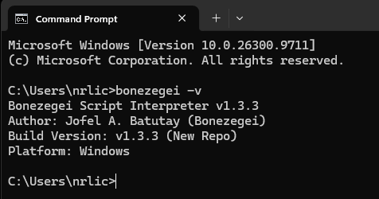
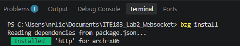
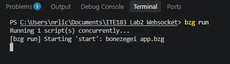
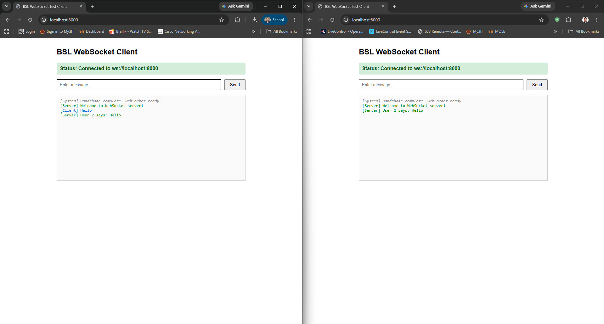
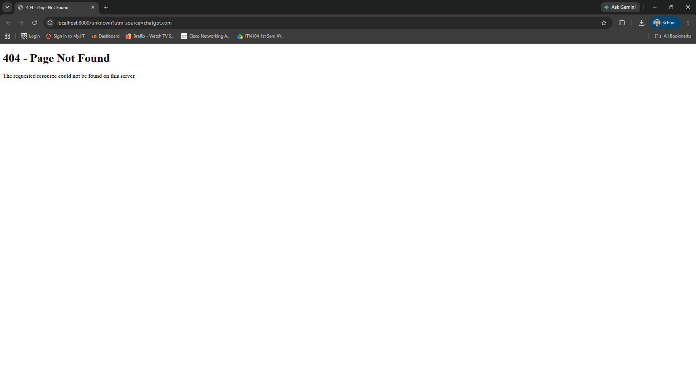
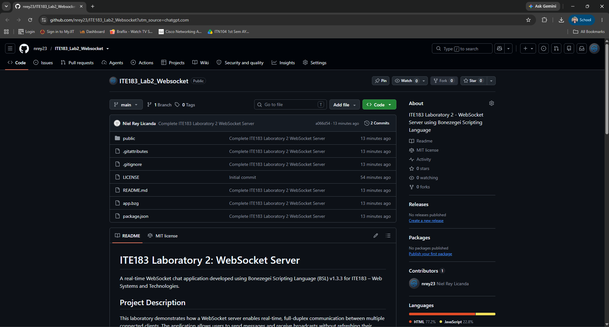

# ITE183 Laboratory 2: WebSocket Server

A real-time WebSocket chat application developed using **Bonezegei Scripting Language (BSL) v1.3.3** for **ITE183 – Web Systems and Technologies**.

## Project Description

This laboratory demonstrates how a WebSocket server enables real-time, full-duplex communication between multiple connected clients. Users can send messages and receive broadcasts without refreshing their browsers.

## Laboratory Report

The complete laboratory report includes the implementation
process, screenshots, testing results, and conclusion.

[View Laboratory 2 Report (PDF)](docs/Licanda_ITE183_Laboratory_2_WebSocket_Report.pdf)

## Features

- HTTP server running on port `8000`
- WebSocket connection and disconnection handling
- Welcome messages for newly connected clients
- Real-time message broadcasting to all connected clients
- HTML-based chat interface
- Custom page for undefined routes

## Technologies Used

- Bonezegei Scripting Language v1.3.3
- Bonezegei HTTP package
- HTML, CSS, and JavaScript
- WebSocket API
- Visual Studio Code
- Git and GitHub

## Installation and Setup

1. Install **Bonezegei Scripting Language v1.3.3**.
2. Clone this repository and open the project folder:

   ```powershell
   git clone https://github.com/nrey23/ITE183_Lab2_Websocket.git
   cd ITE183_Lab2_Websocket
   ```

3. Verify the interpreter and install the HTTP dependency:

   ```powershell
   bonezegei -v
   bzg install
   ```

4. **Windows runtime note:** On the tested Windows setup, `http.dll` also required `libwinpthread-1.dll`. If `bzg run` reports `Failed to load library: lib/http/http.dll`, check for missing DLL dependencies. In this project, the missing runtime was obtained from the [official MSYS2 x64 UCRT package](https://packages.msys2.org/packages/mingw-w64-ucrt-x86_64-libwinpthread), with the package's published SHA-256 verified. The runtime DLL was placed in the project root. The DLL is not included in this repository; use an official source and retain the applicable license notice.
5. Start the server:

   ```powershell
   bzg run
   ```

6. Open [http://localhost:8000](http://localhost:8000) in a browser while the server is running.

## Testing

Open the application in two browser windows. Send a message from the first window and verify that both windows receive the broadcast. Repeat from the second window to check communication in both directions.

To test the custom error page, open [http://localhost:8000/unknown](http://localhost:8000/unknown).

**Known limitation:** The current implementation displays the custom `404.html` page for an undefined route but returns **HTTP status 200**, not HTTP 404.

## Laboratory Documentation and Screenshots

### 1. Bonezegei Version Verification



**Figure 1. Bonezegei version verification.** I ran `bonezegei -v` to confirm that Bonezegei Scripting Language v1.3.3 was installed on Windows.

### 2. Dependency Installation



**Figure 2. HTTP dependency installation.** I ran `bzg install` in the project directory. The terminal confirmed that the `http` package was installed.

### 3. WebSocket Server Execution



**Figure 3. Server startup.** I executed `bzg run` to start `app.bzg`. I then verified that the application could be opened in a browser.

### 4. Multi-Client WebSocket Broadcasting



**Figure 4. Real-time WebSocket broadcasting.** I opened two browser windows connected to `ws://localhost:8000`. Both completed the handshake, received welcome messages, and displayed a message broadcast from a connected client.

### 5. Custom 404 Page



**Figure 5. Undefined-route handling.** I visited `/unknown` to test an undefined URL. The application displayed the custom *404 - Page Not Found* content. The HTTP response status remains 200, as noted above.

### 6. GitHub Repository



**Figure 6. GitHub repository.** I uploaded the source code, project configuration, README, and MIT License to the public repository. Locally installed dependencies are excluded using `.gitignore`.

## Troubleshooting Summary

During initial testing, the server displayed `Failed to load library: lib/http/http.dll`, followed by an undefined `http` variable. The HTTP DLL existed, and both the Bonezegei executable and the HTTP DLL were 64-bit. A Windows DLL-loading check returned error 126. Further diagnosis identified the missing `libwinpthread-1.dll` dependency.

After obtaining the runtime from the official MSYS2 package and making it available in the project directory, the server started successfully. The missing runtime is excluded from Git, so another Windows machine may need the same setup step.

## Project Structure

```text
ITE183_Lab2_Websocket/
├── .gitattributes
├── .gitignore
├── LICENSE
├── README.md
├── app.bzg
├── package.json
├── public/
│   ├── index.html
│   └── 404.html
└── screenshots/
    ├── 01_Bonezegei_Version.png
    ├── 02_Dependency_Installation.png
    ├── 03_Server_Running.png
    ├── 04_WebSocket_Broadcast.png
    ├── 05_Custom_404.png
    └── 06_GitHub_Repository.png
```

The locally installed `lib/` directory and `libwinpthread-1.dll` are excluded from Git and are required only in the local runtime environment.

## Conclusion

Through this laboratory, I learned how to set up an HTTP and WebSocket server with Bonezegei, handle client connections, send welcome messages, and broadcast messages to multiple clients in real time. I also learned how to troubleshoot a missing Windows runtime dependency and document my work using GitHub.

## Reference

[BSL HTTP and WebSocket – Professor's Sample Repository](https://github.com/msuiit-ph/BSL_HTTP_and_WebSocket)

## License

This project is licensed under the [MIT License](LICENSE).
